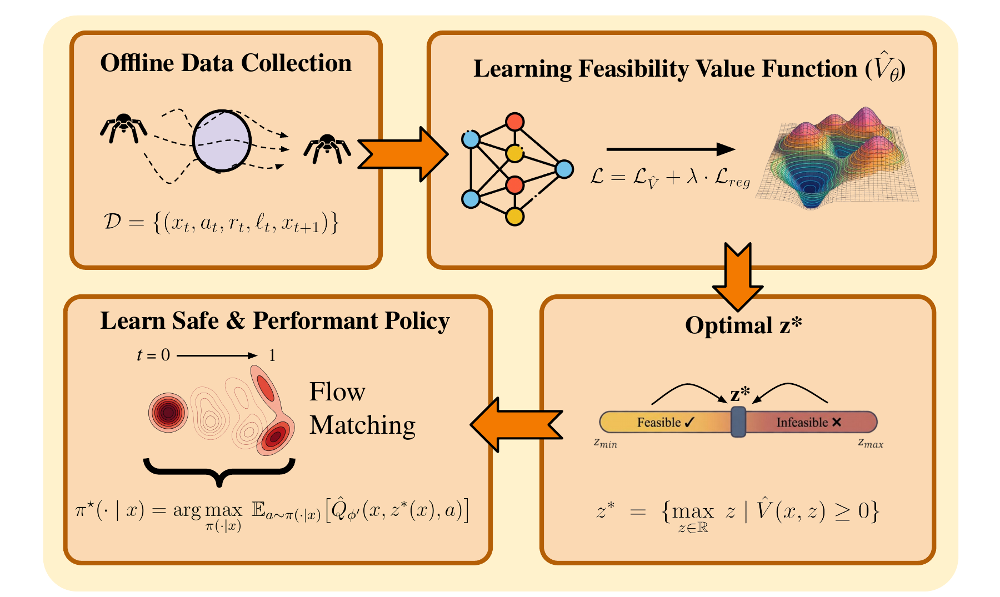

# EpiFlow: Bridging Safety and Performance in Offline Reinforcement Learning via Epigraph-Guided Flow Matching
40th Conference on Neural Information Processing Systems (NeurIPS), 2026

Manan Tayal\*†, Mumuksh Tayal\*, Ravi Prakash

\*Equal contribution &nbsp; †Work done while at the Indian Institute of Science, Bengaluru

[**[Paper]**](https://arxiv.org/pdf/2602.08054)  [**[arXiv]**](https://arxiv.org/abs/2602.08054)  [**[Project Page]**](https://tau-intelligence.com/EpiFlow/)

EpiFlow formulates safe offline reinforcement learning as a state-constrained optimal control problem, where safety is enforced as a hard state constraint and performance is captured by a reward. It learns an epigraph feasibility value function from a fixed dataset through a bounded Bellman recursion, and extracts a one-step flow-matching policy that maximizes return at the largest safely achievable performance level. Across Boat Navigation, Safety-Gymnasium and Bullet-Safety-Gym tasks, EpiFlow achieves competitive returns with near-zero constraint violations.



# Method
EpiFlow is built on the [SafeFQL](https://github.com/tayalmanan28/safe-fql) codebase. The agent ([`jaxrl5/agents/epiflow/epiflow.py`](jaxrl5/agents/epiflow/epiflow.py)) trains all components jointly with SafeFQL's training loop:

**Epigraph feasibility value function (Algorithm 1).**
With the epigraph variable $z \sim \mathcal U[z_{\min}, z_{\max}]$ and $z' = (z - r)/\gamma$,
- $\hat Q(x,z,a)$ regresses onto the (discounted HJ) Bellman target $(1-\gamma)\,\ell(x) + \gamma \min\{\ell(x),\ \hat V(x',z')\}$ (Eq. 8–9);
- $\hat V(x,z)$ is the $\tau$-expectile of $\hat Q$ plus the decomposition regularizer
  $\lambda\,\max\{0,\ \hat V(x,z) - \min(V_r(x)-z,\ V_s(x))\}$ that keeps it sensitive to $z$ (Eq. 10–12);
- the reward value $V_r$ and safety value $V_s$ are SafeFQL's IQL-style reward and HJ cost critics (Eq. 30–33).

**Flow-matching policy synthesis (Algorithm 2).**
- The state-wise budget $z^\star(x) = \sup\{z \mid \hat V(x,z) \ge 0\}$ is found by bisection (Eq. 13);
- a flow behavior teacher $\mu_\zeta$ is trained by conditional flow matching (Eq. 15);
- a one-step actor $\mu_\omega$ minimizes $-\hat Q(x, z^\star(x), \mu_\omega(x,\eta)) + \alpha\,\lVert\mu_\omega(x,\eta)-\mu_\zeta(x,\eta)\rVert^2$ (Eq. 16–17).

At deployment only the one-step actor is queried, i.e. a single forward pass per action.

## Installation
``` Bash
conda env create -f environment.yml
conda activate EpiFlow
```
or `pip install -r requirements.txt` in a Python 3.9 environment. Safety-Gymnasium and Bullet-Safety-Gym datasets are downloaded automatically by [DSRL](https://github.com/liuzuxin/DSRL). The Boat Navigation dataset is included in [`data/`](data/) and is otherwise downloaded from our [Hugging Face dataset](https://huggingface.co/datasets/tayalmanan/SafeBoatData).

## Training
All commands are run from the repository root.
``` Bash
bash scripts/run.sh
```
trains EpiFlow on Safe Boat Navigation, evaluates it and draws the figures. A single run on any task is
``` Bash
python launcher/examples/train_offline.py --env_id <ENV_ID> --config configs/train_config.py:epiflow --config.seed=0
```
where `ENV_ID` indexes [`env/env_list.py`](env/env_list.py):

| Suite | Tasks (`env_id`) |
| --- | --- |
| Boat Navigation | BoatRobot (30) |
| Safety-Gymnasium – Safe Velocity | HalfCheetah (17), Hopper (18), Ant (16), Walker2d (20), Swimmer (19) |
| Safety-Gymnasium – Safe Navigation | CarButton1 (0), CarGoal1 (4), CarPush1 (6) |
| Bullet-Safety-Gym | AntRun (22), BallRun (28), CarRun (25), DroneRun (23), AntCircle (26), BallCircle (27), CarCircle (21), DroneCircle (24) |

The resolved config and the checkpoints (`model<k>.pickle` every `eval_interval` steps and `model_final.pickle`) are written to `results/<env_name>/<experiment_name>_<date>_s<seed>_<id>/`. `--alpha` and `--reg_weight` override $\alpha$ and $\lambda$, and `EPIFLOW_MAX_STEPS` overrides the number of training steps.

To reproduce all main results (5 seeds per task) and the ablations of Section 4.3 / Appendix C:
``` Bash
bash scripts/train_all.sh
bash scripts/ablations.sh
```

## Evaluation
``` Bash
python launcher/examples/evaluate_policy.py --run_dir results/BoatRobot/EpiFlow_*
```
evaluates each run on 500 fixed initial states (episode `i` is reset with seed `i` for DSRL tasks; 500 fixed safe initial states for Boat Navigation) and reports mean ± std across seeds of the normalized reward $(R-r_{\min})/(r_{\max}-r_{\min})$ and normalized cost $C/\kappa$ with $\kappa = 10$ (DSRL protocol), plus the raw return, cost and safety rate. `--action_noise 0.05` adds Gaussian perturbations to the executed actions (Appendix C.2).

## Visualization
For Boat Navigation,
``` Bash
python launcher/viz/viz_boat.py --run_dir results/BoatRobot/<run>
```
plots $\hat V(x,z)$ for several $z$ (Fig. 7), the budget $z^\star(x)$ (Fig. 10) and policy rollouts. The scripts used for the figures in the paper are in [`plots/`](plots/).

## Hyperparameters
Defaults in [`configs/train_config.py`](configs/train_config.py) follow SafeFQL:

| Hyperparameter | Value |
| --- | --- |
| Critic / value networks | MLP, ReLU, 2×256, 2 critics (clipped double Q) |
| Actor (flow teacher and one-step policy) | MLP, GELU, 4×512 |
| Optimizer / learning rate | Adam / 3e-4 |
| Discount $\gamma$ / target EMA | 0.99 / 0.005 |
| Expectile $\tau$ | 0.9 |
| Regularizer weight $\lambda$ | 0.25 |
| Distillation coefficient $\alpha$ | 0.1 |
| Flow teacher Euler steps | 10 |
| Training steps | 100k |
| Batch size | 2048 (Boat: 1024), split in two halves for the actor; critics use 256 |
| $[z_{\min}, z_{\max}]$ | $[\min_{\mathcal D} r,\ \max_{\mathcal D} r] / (1-\gamma)$ |
| Safety function, Boat Navigation | $\ell(x) = \min_i \left(\lVert x - c_i\rVert - r_i\right)$, signed distance to the closest obstacle (`h` in the dataset) |
| Safety function, DSRL tasks | $\ell(x) = +1$ if cost $=0$, $-25$ otherwise |

Any value can be overridden from the command line, e.g. `--config.agent_kwargs.reg_weight=0.5`. Tips:
* $\lambda$ trades off the Bellman recursion against the decomposition bound; a useful range is 0.1–0.5. Check that $\hat V$ varies with $z$ (`viz_boat.py`) when tuning it.
* Larger $\tau$ gives safer policies; $\tau = 0.9$ is used for all experiments.
* Returns are insensitive to $\alpha \in [0.01, 10]$, while cost increases for $\alpha \ge 1$.

## Repository structure
```
configs/            training configuration
env/                Boat Navigation (and Point Robot) environments, list of tasks
jaxrl5/agents/      EpiFlow agent
jaxrl5/networks/    value networks
jaxrl5/data/        DSRL / custom offline datasets
launcher/examples/  training and evaluation entry points
launcher/viz/       value-function and trajectory visualization
plots/              scripts for the figures in the paper
scripts/            main results and ablations
```

## Citation
If you find this work useful, please cite:
``` bibtex
@inproceedings{tayal2026epiflow,
  title={{EpiFlow}: Bridging Safety and Performance in Offline Reinforcement Learning via Epigraph-Guided Flow Matching},
  author={Tayal, Manan and Tayal, Mumuksh and Prakash, Ravi},
  booktitle={Advances in Neural Information Processing Systems (NeurIPS)},
  year={2026}
}
```

## Acknowledgements
This codebase is built on [Safe-FQL](https://github.com/tayalmanan28/safe-fql).
